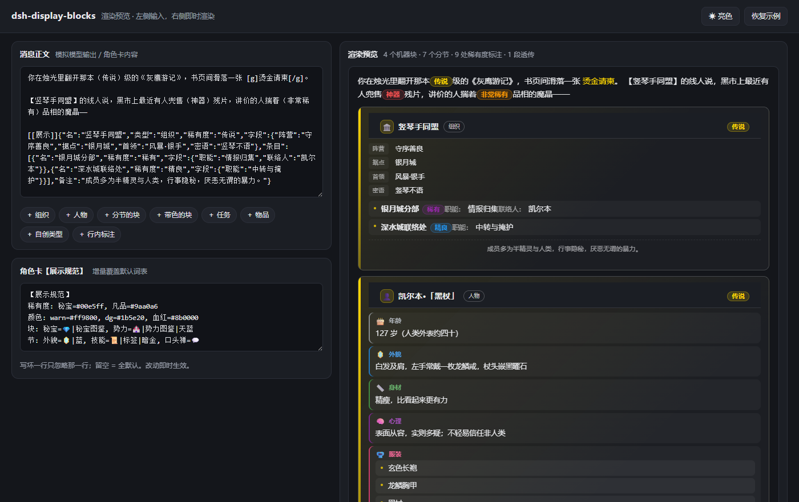
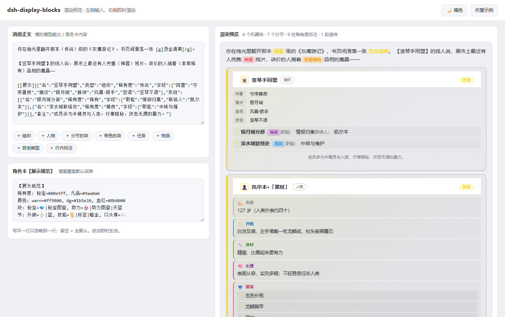
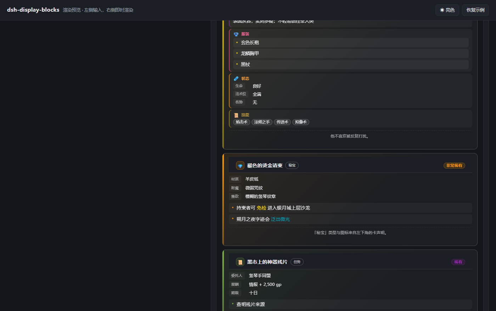

# dsh-display-blocks —— DSH 展示层插件

> **一句话**：把「渲染什么」从代码里拿出来，变成**角色卡能声明的规范**。
> 后端给格式、前端按规范渲染、卡或 AI 自行判断 —— 三方共用同一份数据。

`v0.4.0` ｜ 许可 PolyForm-Noncommercial-1.0.0 ｜ **零 npm 依赖** ｜ Node ≥ 20

| 能力 | 说明 |
|---|---|
| **通用机器块** | `[[任意标记]]{json}` —— 不只商店/装备，组织、人物、任务、秘宝、AI 现编的类型都能渲染成**块状卡片** |
| **分节（骨架）** | 块里想开几节、节叫什么、每节放什么形状的内容，**全由 JSON 自己决定** —— 年龄 / 外貌 / 心理 / 状态 / 服装 / 身材 / 技能，随便开 |
| **行内标注** | `（传说）` 按稀有度上色；`[g]金色文字[/g]` / `[血红]警告[/血红]` / `[#00e5ff]任意色[/#00e5ff]` |
| **颜色可声明** | 卡片 / 节 / 条目都能各带各的颜色，四级回落统一入口；色值可写 `#hex`、色名（`紫` `gold`）或稀有度词 |
| **词表驱动** | 卡里写一段 `【展示规范】` 就能扩充稀有度词、颜色名、块类型图标与默认色、**节的图标 / 版式 / 默认色** |
| **失败安全** | 客户端每一处接触都单独 try/catch；渲染不出来只影响那一处，绝不带崩 GUI |
| **主题自适应** | 卡片样式全程由 `currentColor` 派生，DSH 亮 / 暗主题都不用另配 |

## 目录

- [0. 效果预览](#0-效果预览)
- [1. 本地 Demo（改样式 / 词表不用重启）](#1-本地-demo改样式--词表不用重启)
- [2. 后端格式要求（模型 / 角色卡要遵守的）](#2-后端格式要求模型--角色卡要遵守的)
  - [2.1 通用机器块](#21-通用机器块) ｜ [2.2 分节：结构自己长](#22-分节结构自己长) ｜ [2.3 行内标注](#23-行内标注) ｜ [2.4 角色卡侧声明展示规范](#24-角色卡侧声明展示规范) ｜ [2.5 颜色：四级回落](#25-颜色四级回落)
- [3. 前端渲染](#3-前端渲染)
- [4. 安装 / 构建 / 测试](#4-安装--构建--测试)
- [5. 与 DND 皮肤的分工](#5-与-dnd-皮肤的分工)
- [6. 已知边界](#6-已知边界)
- [7. 版本与许可](#7-版本与许可)

---

## 0. 效果预览

机器块渲染成**独立面板**：左侧一条跟稀有度走的强调条、图标色块、类型徽章、
稀有度胶囊（右对齐）、字段两列对齐、条目行式小卡、脚注虚线分隔。

**暗色主题**



**亮色主题**（同一份 CSS，没有任何主题分支）



---

## 1. 本地 Demo（改样式 / 词表不用重启）

```powershell
node D:\DSH\display-blocks\tools\build-demo.mjs
# 然后双击 D:\DSH\display-blocks\demo\index.html
```

- 左边改**消息正文**与**卡声明**，右边即时渲染 —— 调样式、试词表不用重启 DSH 桌面端。
- 与插件**同一条链路**：内联的就是 `lib/{spec,parse,render,client}.js`，用的就是插件那份 CSS 与 `toDom`。**预览所见 = 实机所见**。
- 面板底部「生效词表」实时列出稀有度 / 颜色短码 / 块类型 / 默认不接管标记。
- 顶部按钮切换亮暗主题（记入 localStorage）；也可直接用锚点：`demo\index.html#light`、`#dark`。
- 为什么是构建产物而不是直接 `import`：ES module 在 `file://` 下会被 CORS 拦，双击必报错 ——
  所以把四个模块剥掉 import/export 后内联进单文件 HTML，零依赖、双击即开。

---

## 2. 后端格式要求（模型 / 角色卡要遵守的）

### 2.1 通用机器块

```
[[标记]]{"名":"标题","类型":"组织","稀有度":"传说","节":[{"名":"外貌","值":"…"}],"字段":{"任意键":"任意值"},"条目":[...],"备注":"脚注"}
```

| 字段 | 必填 | 说明 | 别名 |
|---|---|---|---|
| `名` | 建议 | 卡片标题 | `名称` / `title` / `name` |
| `类型` | ○ | 决定图标与类型徽章；**卡可自行扩充** | `type` / `类别` |
| `稀有度` | ○ | 查词表上色；**词表外则中性显示**，不会吞字 | `rarity` / `品质` |
| `节` | ○ | **分节**：结构自己长，见 [2.2](#22-分节结构自己长) | `sections` / `分节` |
| `字段` | ○ | 自由键值表，渲染成两列（不分节时的快捷写法） | `fields` / `属性` |
| `条目` | ○ | 数组；元素可为字符串，或 `{名,稀有度,字段,备注}` | `items` / `entries` / `列表` |
| `备注` | ○ | 脚注 | `note` / `说明` |

**硬格式**：

1. `[[标记]]{` 之后必须紧跟**一行合法 JSON**：不得换行、不得用单引号、不得有尾逗号、必须用 ASCII 双引号 `"`。
2. 块**可以**出现在正文任意位置（不必独占开头）—— 渲染器锚定标记 + 大括号配平来切，所以正文里的花括号不会切错。
3. **标记由 AI 自行判断**：任何 `[[X]]{json}` 都会被识别，`X` 不在词表里就用兜底样式。想新增一种信息卡，直接发明标记即可。
4. 说明文字里出现 `[[商店]]`（后面没有 `{json}`）**不会**被误判成机器块 —— 这是项目里踩过的真实 bug，判据专门守过。

### 2.2 分节：结构自己长

**渲染器只给骨架，节由内容自己声明。** 想开几节、节叫什么名字，全由 JSON 决定 ——
不存在「只认某几种槽位」的限制。人物的年龄 / 外貌 / 心理 / 状态 / 服装 / 身材 / 技能，
一人一样地写就行：

```json
[[人物]]{"名":"凯尔本·「黑杖」","类型":"人物","稀有度":"传说","节":[
  {"名":"年龄","值":"127 岁（人类外表约四十）"},
  {"名":"外貌","值":"白发及肩，左手常戴一枚龙鳞戒，杖头嵌黑曜石"},
  {"名":"身材","值":"精瘦，比看起来更有力"},
  {"名":"心理","值":"表面从容，实则多疑；不轻易信任非人类"},
  {"名":"服装","值":["玄色长袍","龙鳞胸甲","黑杖"]},
  {"名":"状态","值":{"生命":"良好","法术位":"全满","伤势":"无"}},
  {"名":"技能","布局":"标签","值":["焰击术","法师之手","传送术","拟像术"]}
]}
```

> 上面为了可读性做了换行缩进；**实机必须写成一行**（硬格式第 1 条），或至少 JSON 本身不能有换行。



**版式默认「自动」—— 按值的 JSON 形状自己挑**，所以大部分时候你什么都不用管：

| 值的形状 | 渲染成 |
|---|---|
| 字符串 / 数字 | 一整段文本（仍走行内标注，`（传说）` 照样上色） |
| 数组 | 逐行列表（元素是对象就渲染成条目小卡） |
| 对象 | 两列键值表 |

想强制版式就写 `"布局"`：`文本` / `键值` / `列表` / `标签`（标签 = 一行胶囊，
适合服装、身材、技能名这类短值）。`"图标"` 可以给单节换图标。

**具名节默认是可折叠的**，用的是 **DND 皮肤档案控制台同一套策略**：视觉隐藏的原生控件嵌在节头 `label` 里，
显示交给 `:has(> .dsp-sec-head > .dsp-ctl:checked)`。默认「**第一节展开、其余收起**」；
节上可用 `"折叠"` 调整：

| 写法 | 效果 |
|---|---|
| 不写 | 按位置：第一节开，其余收 |
| `"折叠": true` | 强制收起 |
| `"折叠": false` | 强制展开（重要节别被折起来） |

具名节 ≥2 时卡片下方出现「**展开全部 / 全部收起**」。**无标题节永远展开** —— 没有节头就无处可点，
藏起来就出不去。嵌套节各自独立折叠。`"折叠"` 是描述字段，不会漏进这一节的正文里。

> 为什么不用 `<details>`：原生开合依赖浏览器默认动作，页面上游一拦就点不开，而 JS 再 toggle `open`
> 会与原生行为互相抵消。改用 `:checked` 后，JS 只做幂等的 `checked = !checked`，怎么拦都不会反着来
> —— 这也是皮肤控制台选这条路的同一个理由。

**可扩展度**：折叠规则只看 `:checked` 与类名、**不看节名**。词表外的自定义标记、自定义节名、
未知版式名，一样成节、一样可折叠、一样不吞内容（夹具里有专门断言）。

### 2.2.1 统一渲染出口（DND 皮肤在场时）

装了 DND 皮肤（`dsh-tavern`）时，机器块**不再在正文里插卡片**，而是交给皮肤底部那个
档案控制台，作为一个 tab 出现 —— 一个面板、一套样式、一条代码路径：

```
[[人物]]{…}  ──► 插件解析 ──► window.__DSP__.card() ──► 皮肤控制台的「12 人物」面板
[[状态更新]]{…} ──────────────────────────────────────► 皮肤自己的固定面板（不变）
```

- **API**：`window.__DSP__ = { card(marker, json), iconFor(marker), parse(text), spec() }`
  —— 皮肤不必自己画一遍机器块，**渲染只有一份实现**。
- **开关**（设置 → 展示层 → 「机器块在哪里渲染」）：
  `自动`（默认，皮肤在场就交给它）/ `总是交给皮肤` / `总是本插件内联渲染`。
  自动判据 = `<html data-dsh-skin="dnd-tavern">`；换皮肤/没皮肤时自动退回内联卡片。
- 透传模式下机器块**原文保留**在正文给皮肤拾取；行内标注（稀有度/颜色/骰值）仍由本插件处理。

**四种写法都认**（挑最省事的那种）：

| 写法 | 例子 |
|---|---|
| 描述对象数组（最完整） | `[{"名":"外貌","图标":"👁","布局":"文本","值":"…","折叠":false}]` |
| 映射（最省字） | `{"年龄":"27 岁","身材":"精瘦"}` |
| 单键对象 | `[{"外貌":"白发"}]` |
| 描述字段外全是内容 | `[{"名":"外貌","身高":"175","发色":"银白"}]` → 剩余键自动变这一节的键值表 |

- **节名不在词表里照样渲染**（只是没有默认图标）—— 加图标才需要动 `【展示规范】`。
- **可以嵌套**：某一节的值里再写 `节`，就继续往下分。
- **空节不画**（值为空字符串 / 空数组 / 空对象），免得满屏空框。

### 2.3 行内标注

| 写法 | 效果 | 成立条件 |
|---|---|---|
| `（传说）` `【传说】` `[传说]` | 该词按稀有度配色（渲染为同色系胶囊） | **词表命中**；词表外的 `（某某）` 原样保留 |
| `[g]文字[/g]` | 文字染成金色 | 色码命中**且**有闭合标签 |
| `[血红]文字[/血红]` | 按中文/英文**色名**上色 | 色名命中词表**且**有闭合标签 |
| `[#00e5ff]文字[/#00e5ff]` | 任意颜色 | `#hex` 直写 |
| `[g]获得（传说）之刃[/g]` | 嵌套：整体金色 + 词内传说色 | 两层都成立 |

内置色码：`g` 金 `y` 黄 `o` 橙 `r` 红 `p` 紫 `b` 蓝 `c` 青 `gr` 绿 `m` 褐 `w` 白 `k` 黑。
另有 30+ 色名（`红` `天蓝` `暗金` `玫瑰` `gold` `crimson` …），行内和声明位都能用；
卡可以用 `颜色: 血红=#8b0000` 再加自己的名字。

> 判据纪律：颜色标签**必须命中词表且有闭合**才成立 —— 所以 `[传说]`（稀有度定界符）
> 和 Markdown 链接 `[文字](url)` 都不会被误吃（夹具里有专门断言）。

### 2.4 角色卡侧声明【展示规范】

卡在自己的 `desc` 里加一段（纯文本，AI 也好写）：

```
【展示规范】
稀有度: 凡品=#888888, 秘宝=#00e5ff
颜色: warn=#ff9800, dg=#1b5e20, 血红=#8b0000
块: 秘宝=💎|秘宝图鉴, 势力=🏰|势力图鉴|天蓝
节: 外貌=🪞|蓝, 技能=📜|标签|暗金, 口头禅=💬
```

- `词=值` 一行多条，逗号分隔；
- 块的取值是 `图标|标题|默认色`，后两段可省（省标题就用类型名）；
- 节的取值是 `图标|版式|默认色`；段位缺失时**按「是不是版式名」判定，不瞎猜** ——
  所以 `节: 技能=列表`（版式）、`节: 外貌=👁|文本`（图标|版式）、`节: 外貌=🪞|蓝`（图标|颜色）都成立；
- **增量覆盖 + 补键不改键**：卡只写三条不会把默认丢掉，只写图标不会把默认色洗掉；
  写坏的行整体忽略，不会崩渲染。

### 2.5 颜色：四级回落

颜色在四个地方都能声明，全部走同一个入口（认 `#hex` / 色码 / 色名 / 稀有度词）：

```
卡片强调色：显式「色」 → 「稀有度」 → 该类型的词表默认色 → 兜底褐
节  强调色：显式「色」 → 本节「稀有度」 → 该节的词表默认色 → 继承卡片
条目名    ：显式「色」
行内文字  ：[g]…[/g] ／ [血红]…[/血红] ／ [#00e5ff]…[/#00e5ff]
```

| 位置 | 怎么写 | 例子 |
|---|---|---|
| 卡片 | 块里加 `色` | `{"名":"黑市","类型":"地点","稀有度":"稀有","色":"紫"}` |
| 某一节 | 节里加 `色` 或 `稀有度` | `{"名":"状态","色":"橙","值":{"生命":"良好"}}` |
| 某个条目 | 条目里加 `色` | `{"名":"铜钥匙","色":"金"}` |
| 行内 | 方括号包住 | `持柬者可 [g]免检[/g] 通行` |
| 词表默认色 | `块: 势力=🏰|势力图鉴|天蓝` ／ `节: 外貌=👁|蓝` | 一处改，全卡生效 |

- `色` 可以写 `#8b0000`、`紫`、`gold`，也可以直接写**稀有度词**（`传说` → 词表里的金色）。
- **「色」压过「稀有度」**：写了就用；没写才跟稀有度走；都没有才用类型 / 节的默认色。
- 稀有度**胶囊**始终显示稀有度自己的颜色 —— 用 `色` 改卡片强调色，不会把稀有度标签也染错
  （demo 里的「黑市上的神器残片」就是：左条草绿、稀有度胶囊仍是紫色）。
- 认不出来的色值**不会吞内容**，只是这一级跳过、继续往下回落。

---

## 3. 前端渲染

### 3.1 产出什么

| 输入 | 产出 |
|---|---|
| `[[展示]]{"类型":"组织","名":"竖琴手同盟","稀有度":"传说",...}` | 一张带图标色块、类型徽章、稀有度胶囊的**块状卡片**；`字段` 渲染成两列键值表，`条目` 渲染成行式小卡 |
| `"节":[{"名":"外貌","值":"…"}]` | 卡片内部多出一组**节面板**：每节一个小标题行（图标 + 节名）+ 按值形状选定的内容区 |
| `"色":"紫"` / `{"名":"状态","色":"橙"}` | 卡片强调色 / 该节左侧标记线与标题各自上色，逐级回落 |
| `（神器）` | 该词按 `#ff5252` 着色，带同色系胶囊底 |
| `[g]…[/g]`、`[血红]…[/血红]` | 该段按对应颜色着色 |

### 3.2 视觉设计（为什么长这样）

- **块状工整**：卡片是独立面板（圆角 + 边框 + 轻阴影 + 左侧强调条），
  头部 / 节 / 字段区 / 条目区 / 脚注各自成节 —— 而不是「一段文字加条边」。
  节是一层**浅底子面板 + 左侧标记线 + 小号粗体节名**，多节叠起来仍然对齐。
- **徽章底色从元素自身颜色派生**：`color-mix(in srgb, currentColor 14%, transparent)`。
  渲染树只给 `color`，CSS 自己调出同色系淡底 —— 所以**加视觉不必动渲染树**，夹具也不会被牵动。
- **不预设宿主主题**：所有灰阶从 `currentColor` + `transparent` 混合出来，
  同一份 CSS 在亮色 / 暗色下都成立（见 [效果预览](#0-效果预览) 两张图）。

### 3.3 渲染纪律

- **不接管皮肤负责的块**。默认跳过 `商店 / 升级 / 车卡 / 状态更新 / 状态更正`
  —— 这些是 DND 皮肤自己的渲染器画的，插件不重复画（可在设置里改「接管哪些标记」）。
- **绝不拼 HTML**。抽象渲染树只带 `text` 字段，落 DOM 时一律 `createTextNode`
  —— 模型输出不可信，拼 innerHTML 等于把注入面交出去。夹具里有一条专门断言这个。
- **只改文本节点**，不重建 React 容器；处理过的节点打 `data-dsp-done="1"` 防重复渲染。
- 跳过 `script/style/textarea/input/code/pre` 内部。

### 3.4 架构：纯模块 + 薄壳

```
lib/spec.js     词表：稀有度 / 颜色名 / 块类型（含默认色）/ 节的图标·版式·默认色
                + 卡声明解析 + 增量合并 + resolveColor()            ← 无依赖
lib/parse.js    机器块切分（大括号配平）+ 行内标注解析              ← 依赖 spec
lib/render.js   渲染**抽象树**（分节 / 版式自动 / 颜色回落 / 嵌套）  ← 依赖两者
lib/client.js   DOM 绑定 + 设置面板 + 观察器                      ← 依赖三者
lib/client.bundle.js  ← 由 tools/build-client.mjs 生成（客户端入口）
```

**为什么把渲染做成抽象树**：整套规则能在 Node 里跑夹具（连 jsdom 都不需要），
客户端只剩一次机械的「树 → DOM」转换。渲染规则改错会被夹具当场抓住，
而不是等到浏览器里把 GUI 带崩。

### 3.5 为什么有构建步骤

DSH 的客户端入口必须是**自注册的单文件**（`window.__ModuleLoader__.load({ id, factory })`），
宿主不会替你 bundle —— `dsh-tavern` 的 484 KB `lib/client.manager.bundle.js`、
`dsh-muv-engine` 的 554 KB `lib/client.js` 都是预先打好的。

本插件的构建器有意做得"笨"（剥 import 行、去 `export` 前缀、按依赖顺序拼），
因为四个模块只用了单行 import 与 `export function/const` 两种写法 ——
不为 36 KB 的插件引入一整套 bundler 依赖。构建前会自检**顶层常量重名**
（这个坑真踩过：`PLUGIN_ID` 声明两次 → 整个 bundle 报废）。

**注册 id 必须等于包名**，否则加载器会重复执行同一 bundle，触发
`duplicate factory registration`，Web boot 直接失败。

Demo 页用的是**同一套拼装逻辑**（`tools/build-demo.mjs`），只是多套了一层 HTML 外壳。

---

## 4. 安装 / 构建 / 测试

```powershell
node D:\DSH\display-blocks\tools\build-client.mjs            # 改完 lib/ 下的模块必须重跑
node --test D:\DSH\display-blocks\tests\core.test.js         # 夹具 42 项，纯 Node，不需要浏览器
node D:\DSH\display-blocks\tools\check-client-entry.mjs      # 客户端入口契约自检
node D:\DSH\display-blocks\tools\build-demo.mjs              # 生成 demo/index.html
```

装进 profile（两处编辑 + 重启）：

```jsonc
// C:\Users\m0408\.dsh\profiles\desktop\package.json
"dependencies": { "dsh-display-blocks": "link:D:/DSH/display-blocks" },
"dsh": { "profile": { "bundles": [ /* … */ "dsh-display-blocks" ] } }
```

**不需要 npm 依赖、不需要 node_modules 链接**：本插件是纯 ESM 源码，
不 import 任何 `@deepseek-ai/*`（宿主半边是空 `apply`），
所以启动期的兼容性门禁没有 peer 可查 —— 不会被静默 disable。

---

## 5. 与 DND 皮肤的分工

| 层 | 负责 | 位置 |
|---|---|---|
| DND 皮肤 | `[[商店]]` / `[[升级]]` / `[[车卡]]` / `[[状态更新]]` 的专用渲染 | `C:\Users\m0408\.dsh\skins\dnd-tavern\` |
| 本插件 | **其余一切**通用块 + 行内稀有度/颜色标注 | 本目录 |

两者靠**标记名单**分工，不抢 DOM：插件默认跳过皮肤负责的四个标记。
换一张没有皮肤支持的卡时，把「接管哪些标记」留空，插件就会连通用块一起接过来。

---

## 6. 已知边界

- 行内标注在**代码块内不生效**（`code/pre` 被跳过）—— 这是有意的，免得把示例代码染色。
- `[x]` 形式在 Markdown 链接（`[文字](url)`）旁边可能被误认成色码 —— 只有**色码命中且有闭合**才会替换，所以链接不受影响；但如果链接文字恰好是 `g`、`r` 这类单字母且后面真有 `[/g]`，语义会以标注优先。
- 渲染是**纯展示层**：不写回对话、不改记忆、不改卡。玩家交互（下单、加点）仍由皮肤的对应面板负责。
- 词表大小写不敏感；`#hex` 支持 3/6/8 位。
- `color-mix()` 需要 Chromium 111+；缺失时徽章只失去底色，文字颜色不受影响。
- 节的**嵌套深度上限 4 层**（超过就退化成 JSON 原文），避免模型写出深到失控的结构；**空节不画**。
- 颜色**认不出来不算错**：只是这一级跳过、继续往下回落（不会吞内容、不会染成透明）。
- `色` 这些键是**声明位**——写在块/节的顶层才是「强调色」；写在 `字段` 里就只是普通数据。

---

## 7. 版本与许可

- 变更记录见 [CHANGELOG.md](CHANGELOG.md)。
- 许可：**PolyForm Noncommercial License 1.0.0**（全文见 [LICENSE](LICENSE)）——
  非商业用途自由使用、修改、再分发；商业用途需另行授权。
